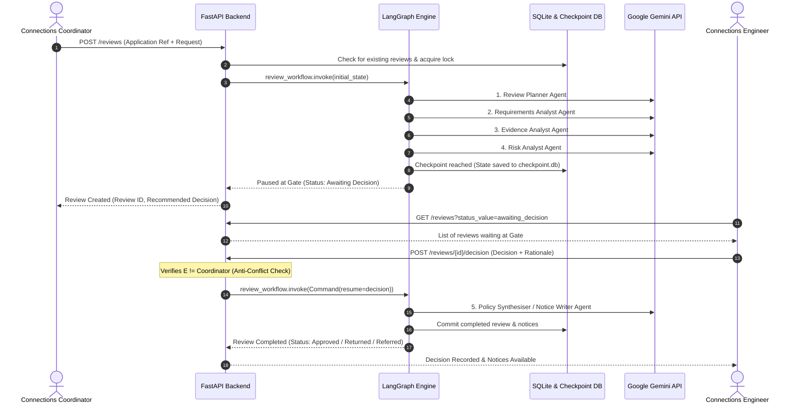

# PhaseWise AI — System Architecture & Design

## 1. Executive Summary

**PhaseWise AI** is an enterprise-grade, multi-agent AI review and decision platform designed for **Merrowdale Power Networks**, a fictional UK Distribution Network Operator (DNO). The platform automates the intake, screening, technical validation, risk scoring, and multi-agent synthesis of residential Low-Carbon Technology (LCT) connection applications—including Electric Vehicle Charge Points (EVCP), Heat Pumps (HP), Vehicle-to-Grid chargers (V2G), Solar Photovoltaic (PV) installations, and Battery Energy Storage Systems (BESS).

The platform enforces strict regulatory compliance, electrical safety standards (BS 7671, EREC G98/G99/G100), cut-out fuse protection, and substation thermal capacity limits. It features deterministic engineering screening, machine-learning risk and duration estimation, retrieval-augmented generation (RAG) over engineering connection standards, and a LangGraph-orchestrated multi-agent review workflow governed by a human-in-the-loop gate.

---

## 2. System Architecture Diagram

```
+-----------------------------------------------------------------------------------+
|                                  CLIENT LAYER                                     |
|                                                                                   |
|  +-----------------------------------------------------------------------------+  |
|  |           Streamlit Web Dashboard (Port 8501) - dashboard/run_dashboard.py   |  |
|  |  +----------------+ +----------------+ +----------------+ +---------------+  |  |
|  |  |  App Queue     | | App Detail     | | Decision Gate  | | Audit Trail   |  |  |
|  |  |  (Coordinator) | | (All Roles)    | | (Engineer)     | | (Staff/Admin) |  |  |
|  |  +----------------+ +----------------+ +----------------+ +---------------+  |  |
|  |  +-----------------------------------+ +----------------------------------+  |  |
|  |  | RAG Connection Chat (Advisors/All)| | Role-Based Navigation & Styling  |  |  |
|  |  +-----------------------------------+ +----------------------------------+  |  |
|  +-----------------------------------------------------------------------------+  |
+------------------------------------------+----------------------------------------+
                                           | HTTP / REST (X-Session-Token Auth)
                                           v
+-----------------------------------------------------------------------------------+
|                                API SERVICE LAYER                                  |
|                                                                                   |
|  +-----------------------------------------------------------------------------+  |
|  |             FastAPI Application (Port 8081) - api/routes.py                 |  |
|  |  - Auth & RBAC Guard: access/permissions.py (Argon2id / PBKDF2 / SHA-256)   |  |
|  |  - Queue Management & Ranking: tools/application_data_tools.py              |  |
|  |  - Review Execution & Human-in-the-loop Resumption: LangGraph State Graph   |  |
|  |  - Audit & Telemetry Logging: persistence/repository.py                     |  |
|  |  - Exception Handlers: 401, 403, 404, 409, 422, 502 with diagnostic payloads|  |
|  +-----------------------------------------------------------------------------+  |
+---------+--------------------+---------------------+--------------------+---------+
          |                    |                     |                    |
          v                    v                     v                    v
+------------------+ +------------------+ +------------------+ +--------------------+
|  DETERMINISTIC   | | MACHINE LEARNING | | RAG & KNOWLEDGE  | | LANGGRAPH WORKFLOW |
|  SCREENING       | | MODELS           | | BASE             | | MULTI-AGENT ENGINE |
|                  | |                  | |                  | |                    |
| tools/           | | modeling/        | | knowledge/       | | agentic/           |
| screening_tools  | | network_work_mod | | vector_index.py  | | review_planner     |
|                  | | duration_model   | | chunk_splitting  | | requirements_agent |
| - Standard check | | sentence_model   | | pdf_extraction   | | evidence_analyst   |
| - Rating stated  | |                  | |                  | | risk_analyst       |
| - Earthing check | - ROC AUC >= 0.85  | - 16 Standards &   | | policy_synthesiser |
| - Cut-out limit  | - R² >= 0.78       |   Guides (PDFs)    | |                    |
| - Triggers flag  | - Macro F1 >= 0.97 | - ChromaDB Vector  | - SqliteSaver Check- |
| - Open decisions | - Scikit-learn     |   Store            |   pointing at Gate   |
+------------------+ +------------------+ +------------------+ +--------------------+
          |                    |                     |                    |
          +--------------------+----------+----------+--------------------+
                                          |
                                          v
+-----------------------------------------------------------------------------------+
|                               PERSISTENCE LAYER                                   |
|                                                                                   |
|  +----------------------------------------+ +----------------------------------+  |
|  | SQLite Database (database/phasewise.db)| | Checkpoint Store                 |  |
|  | - user_accounts (14 seed users, RBAC)  | | (database/checkpoint.db)         |  |
|  | - application_reviews (Full reviews)   | | - LangGraph binary thread state  |  |
|  | - review_decisions (Audit trail)       | | - Pauses review before engineer  |  |
|  | - agent_runs (Execution state)         | |   decision; resumes cleanly      |  |
|  | - llm_calls (Token & latency telemetry)| +----------------------------------+  |
|  | - chat_turns (Conversational memory)   |                                       |
|  +----------------------------------------+                                       |
+-----------------------------------------------------------------------------------+
```

---

## 3. High-Level Subsystems

### 3.1 Data Pipeline & ETL (`data_pipeline/`)
Extracts, normalizes, and cleans raw historical and incoming data streams from three distinct installer portals (**Wattcroft**, **InstallerLine**, and **SiteWren**):
- **Unit Harmonization**: Translates divergent power representations (e.g. `32A`, `7.2kW`, `7200W`, `16.56kVA`) to amperes ($A$) and kilowatts ($kW$).
- **Power Factor Normalization**: Converts percentages (e.g., `95%`), leading decimals (`.95`), and standard floats (`0.95`) into uniform float representations.
- **Reference Normalization**: Normalizes references (`LC-30801`, `30801`, `LCT0030801`) to consistent canonical formats (`LCT0030801`).
- **Revision Tracking**: Deduplicates applications submitted across revisions, retaining the latest valid submission.
- **Quality Profiling**: Generates `output/data_quality_report.json` auditing total received vs. kept rows, anomaly detection, and data rejection rationale.

### 3.2 Deterministic Engineering Screening (`tools/screening_tools.py`)
Screening rules evaluate applications against the 5 primary connection standards:
- **EV Charge Points (EVCP)**: Standard `Connection-Standard-EV-Charge-Point.pdf`
- **Heat Pumps (HP)**: Standard `Connection-Standard-Heat-Pump.pdf`
- **Vehicle-to-Grid (V2G)**: Standard `Connection-Standard-Vehicle-To-Grid.pdf`
- **Solar PV (PV)**: Standard `Connection-Standard-Solar-PV.pdf`
- **Battery Storage (BESS)**: Standard `Connection-Standard-Battery-Storage.pdf`

Screening checks include:
1. **Mandatory Rating Check**: Ensures the appliance rating is declared. Blank ratings immediately block automatic approval.
2. **Cut-Out Capacity Headroom**: Checks appliance demand against the property's service fuse (e.g., 60A, 80A, 100A).
3. **Earthing Compliance**: Validates PME / TN-C-S earthing suitability, open-PEN detection, or dedicated earth electrodes.
4. **Export Limitation & Network Triggers**: Identifies looped service cables, 3-phase unbalance risks, and substation thermal constraints.
5. **Open Decision Space**: Restricts permissible outcomes to a valid subset among `{Approve, Return, Refer}`.

### 3.3 Machine Learning Subsystem (`modeling/`)
PhaseWise AI employs three supervised machine learning models trained on cleaned operational extracts:
1. **Network Work Classifier (`network_work_model.pkl`)**:
   - Predicts whether physical network reinforcement (cable overlay, transformer uprating) is required.
   - Evaluated on held-out evaluation datasets with **held-out ROC AUC > 0.85** (production requirement $\ge 0.82$).
   - Output likelihoods mapped to risk bands: `Low (<0.35)`, `Moderate (0.35-0.65)`, `High (>0.65)`.
2. **Working Days Duration Regressor (`duration_model.pkl`)**:
   - Predicts expected working days from application intake to energisation.
   - Evaluated on held-out test data achieving **held-out $R^2 > 0.78$** and Mean Absolute Error (MAE) of $\approx 3.55$ working days.
   - Flags applications where expected delivery exceeds planned deadlines.
3. **Sentence Classification Model (`sentence_model.pkl`)**:
   - Evaluates sentences within installer statements using TF-IDF feature extraction.
   - Classifies statements into technical categories: `RATING`, `SUPPLY`, `EARTHING`, `SMART_FUNCTIONALITY`, `OUT_OF_SCOPE`.
   - Achieves **macro $F_1 > 0.97$** on held-out sentences.

### 3.4 Vector Search & RAG Knowledge Base (`knowledge/`)
- Ingests 16 official Merrowdale policy and engineering documents from `data/docs/`.
- Splits documents into hierarchical sections and semantic chunk passages.
- Generates vector embeddings using sentence transformers (`all-MiniLM-L6-v2`) stored within an embedded **ChromaDB** collection (`database/chroma_store/`).
- Performs similarity search constrained by cosine distance thresholds ($< 0.85$) to guarantee that generated chat responses originate strictly from company documents without hallucination.

### 3.5 Multi-Agent LangGraph State Machine (`agentic/`)
The application review process is governed by a stateful multi-agent graph implemented with **LangGraph**:
1. **Review Planner Agent**: Formulates a structured examination plan addressing the Coordinator's specific instructions.
2. **Requirements Analyst Agent**: Validates technical specifications against the relevant connection standard.
3. **Evidence Analyst Agent**: Scans installer statement sentences, extracts stated electrical currents, and flags discrepancies against the form.
4. **Risk Analyst Agent**: Incorporates ML predictions, network work likelihood, and duration variances into an overall risk profile.
5. **Human Decision Gate (Checkpoint)**: Execution pauses (`interrupt`) before any decision is finalised. The review state is committed to `database/checkpoint.db` via `SqliteSaver`.
6. **Policy Synthesiser / Notice Writer Agent**: Triggered after a human Connections Engineer records a decision. Produces:
   - Official **Installer Notice** (Approval Letter, Return Notice with required documents, or Referral Notice for network planning).
   - Official **Household Notice** explaining the outcome in non-technical terms.
   - Technical **Assessment Brief** for engineering file retention.

### 3.6 Access Control & Role-Based Security (`access/`)
PhaseWise AI implements strict Role-Based Access Control (RBAC):
- **Connections Engineer**: Access to Queue, Detail, Decision Gate, Audit Trail, and Connection Chat. Can review, authorize, and record final connection decisions. Enforces anti-conflict rule: an engineer cannot decide a review they personally initiated.
- **Connections Coordinator**: Access to Queue, Detail, initiating reviews, Audit Trail, and Connection Chat. Forbidden from accessing the Decision Gate or executing decisions.
- **Customer Service Advisor**: Access exclusively to Connection Chat. Gated from seeing internal queues, engineering screening details, or predictive ML outputs.

---

## 4. End-to-End Execution Flow


