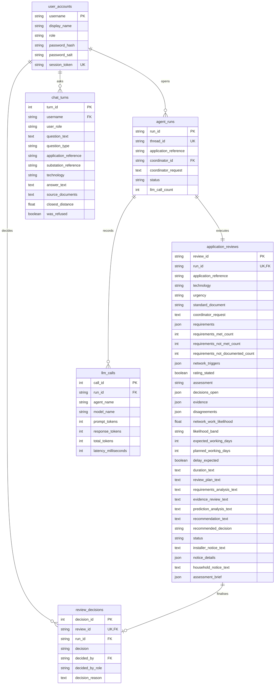

# PhaseWise AI — Database Schema & Data Dictionary

The persistence layer in PhaseWise AI utilizes **SQLAlchemy 2.0 ORM** backed by **SQLite**.
Two primary database files reside in `database/`:
1. `database/phasewise.db`: Core operational relational database storing accounts, reviews, decisions, LLM telemetry, and chat history.
2. `database/checkpoint.db`: LangGraph binary checkpoint storage managing state snapshots across multi-agent review executions.

---

## 1. Entity-Relationship Model

---

## 2. Table Specifications

### 2.1 `user_accounts`
Stores staff credentials, role-based access attributes, and single-session authentication tokens.

| Column | Type | Nullable | Constraints | Description |
|---|---|---|---|---|
| `username` | `VARCHAR` | No | Primary Key | Unique account username (e.g. `amira`, `ravi`, `zara`) |
| `display_name` | `VARCHAR` | No | | Full employee name (e.g. `Amira Okafor`) |
| `role` | `VARCHAR` | No | | Role designation (`Connections Engineer`, `Connections Coordinator`, `Customer Service Advisor`) |
| `password_hash` | `VARCHAR` | No | | Argon2id / PBKDF2 / SHA-256 salted hash |
| `password_salt` | `VARCHAR` | No | | 16-byte random hex salt |
| `session_token` | `VARCHAR` | Yes | Unique | Active session token (URL-safe base64, null when signed out) |

---

### 2.2 `agent_runs`
Tracks each invocation of the LangGraph multi-agent workflow.

| Column | Type | Nullable | Constraints | Description |
|---|---|---|---|---|
| `run_id` | `VARCHAR` | No | Primary Key | Unique run identifier (e.g. `RUN-20261112-9A4F`) |
| `thread_id` | `VARCHAR` | No | Unique | LangGraph thread identifier for checkpoint persistence |
| `application_reference` | `VARCHAR` | No | | Reference of application under review |
| `coordinator_id` | `VARCHAR` | No | | Username of coordinator who initiated review |
| `coordinator_request` | `TEXT` | No | | Prompt / instructions supplied for the review |
| `status` | `VARCHAR` | No | | Execution status (`running`, `paused`, `completed`, `failed`) |
| `llm_call_count` | `INTEGER` | No | | Number of Gemini LLM calls consumed by the run |

---

### 2.3 `application_reviews`
Central repository of full application review records, including deterministic screening, ML risk bands, agent write-ups, and formal notices.

| Column | Type | Nullable | Description |
|---|---|---|---|
| `review_id` | `VARCHAR` | No (PK) | Unique review identifier (e.g. `REV-LCT0052125-9A4F`) |
| `run_id` | `VARCHAR` | No (Unique) | Associated agent run ID |
| `application_reference` | `VARCHAR` | No | LCT application reference (e.g. `LCT0052125`) |
| `technology` | `VARCHAR` | No | Technology code (`EVCP`, `HP`, `V2G`, `PV`, `BESS`) |
| `urgency` | `VARCHAR` | Yes | Urgency flag (`Emergency - Heating System Failed`) |
| `standard_document` | `VARCHAR` | No | PDF filename of governing Connection Standard |
| `coordinator_request` | `TEXT` | No | Original coordinator prompt |
| `requirements` | `JSON` | No | List of requirement evaluations (`Met`, `Not met`, `Not documented`) |
| `requirements_met_count` | `INTEGER` | No | Count of satisfied standard requirements |
| `requirements_not_met_count` | `INTEGER` | No | Count of violated requirements |
| `requirements_not_documented_count` | `INTEGER` | No | Count of missing/blank requirement answers |
| `network_triggers` | `JSON` | No | List of network triggers identified |
| `rating_stated` | `BOOLEAN` | No | True if rated electrical current was declared |
| `assessment` | `VARCHAR` | No | Deterministic rule assessment (`Approve`, `Return`, `Refer`) |
| `decisions_open` | `JSON` | No | Subset of decisions open to the engineer |
| `evidence` | `JSON` | No | Extracted statements and classified findings |
| `disagreements` | `JSON` | No | Discrepancies between statement amperes and form amperes |
| `network_work_likelihood` | `FLOAT` | No | Model probability of requiring network reinforcement |
| `likelihood_band` | `VARCHAR` | No | Risk band (`Low`, `Moderate`, `High`) |
| `expected_working_days` | `INTEGER` | No | Model regression of completion working days |
| `planned_working_days` | `INTEGER` | Yes | Target SLA days from portal/application |
| `delay_expected` | `BOOLEAN` | Yes | True if expected working days > planned days |
| `duration_text` | `TEXT` | No | Formatted duration description |
| `review_plan_text` | `TEXT` | No | Output from Review Planner Agent |
| `requirements_analysis_text` | `TEXT` | No | Output from Requirements Analyst Agent |
| `evidence_review_text` | `TEXT` | No | Output from Evidence Analyst Agent |
| `prediction_analysis_text` | `TEXT` | No | Output from Risk Analyst Agent |
| `recommendation_text` | `TEXT` | No | Output from Policy Synthesiser Agent |
| `recommended_decision` | `VARCHAR` | No | Agent's recommended decision (`Approve`, `Return`, `Refer`) |
| `status` | `VARCHAR` | No | Lifecycle status (`awaiting_decision`, `approved`, `returned`, `referred`) |
| `installer_notice_text` | `TEXT` | Yes | Formal notice letter to the installer |
| `notice_details` | `JSON` | Yes | Structured metadata regarding notice clauses |
| `household_notice_text` | `TEXT` | Yes | Plain-English letter to homeowner |
| `assessment_brief` | `JSON` | Yes | Internal technical summary brief |

---

### 2.4 `review_decisions`
Audit trail of final decisions made by human Connections Engineers.

| Column | Type | Nullable | Constraints | Description |
|---|---|---|---|---|
| `decision_id` | `INTEGER` | No | PK, Auto | Surrogate primary key |
| `review_id` | `VARCHAR` | No | Unique | Associated review ID |
| `run_id` | `VARCHAR` | No | | Associated agent run ID |
| `decision` | `VARCHAR` | No | | Recorded decision (`Approve`, `Return`, `Refer`) |
| `decided_by` | `VARCHAR` | No | | Username of Connections Engineer |
| `decided_by_role` | `VARCHAR` | No | | Role of decider (`Connections Engineer`) |
| `decision_reason` | `TEXT` | No | | Written justification entered by the engineer |

---

### 2.5 `llm_calls`
Telemetry and token consumption log for every LLM interaction.

| Column | Type | Nullable | Constraints | Description |
|---|---|---|---|---|
| `call_id` | `INTEGER` | No | PK, Auto | Surrogate primary key |
| `run_id` | `VARCHAR` | No | | Associated agent run ID |
| `agent_name` | `VARCHAR` | No | | Name of agent making the call |
| `model_name` | `VARCHAR` | No | | Gemini model identifier (e.g. `gemini-3.5-flash-lite`) |
| `prompt_tokens` | `INTEGER` | No | | Input tokens counted |
| `response_tokens`| `INTEGER` | No | | Output tokens generated |
| `total_tokens` | `INTEGER` | No | | Sum of prompt and candidate tokens |
| `latency_milliseconds` | `INTEGER` | No | | Wall-clock latency in milliseconds |

---

### 2.6 `chat_turns`
Record of questions asked to the Connection Assistant and their grounding sources.

| Column | Type | Nullable | Constraints | Description |
|---|---|---|---|---|
| `turn_id` | `INTEGER` | No | PK, Auto | Surrogate primary key |
| `username` | `VARCHAR` | No | | Username of the inquirer |
| `user_role` | `VARCHAR` | No | | User role at time of query |
| `question_text` | `TEXT` | No | | Natural language prompt |
| `question_type` | `VARCHAR` | No | | Classified query intent |
| `application_reference` | `VARCHAR` | Yes | | Referenced application if detected |
| `substation_reference` | `VARCHAR` | Yes | | Referenced substation if detected |
| `technology` | `VARCHAR` | Yes | | Referenced technology if detected |
| `answer_text` | `TEXT` | No | | Assistant response |
| `source_documents` | `TEXT` | No | | Comma-separated list of grounding PDF files |
| `closest_distance` | `FLOAT` | No | | Cosine distance of nearest matching embedding chunk |
| `was_refused` | `BOOLEAN` | No | | True if request was blocked by role guardrails |
